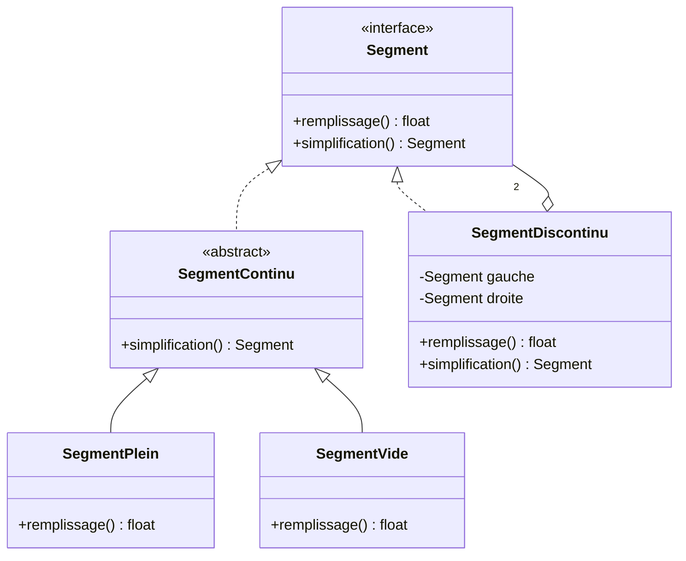

# Recursive Segments — Composite Pattern in Java

A small object-oriented Java project that models **one-dimensional segments** as a recursive tree structure, computes their **fill ratio**, and **simplifies** them by merging redundant sub-segments.

It was written as a university lab assignment and focuses on clean OOP design: the Composite pattern, recursion, and a deliberate choice between interfaces and abstract classes.

---

## The problem

A segment is one of two things:

- **Continuous**: entirely *full* (`plein`) or entirely *empty* (`vide`).
- **Discontinuous**: split into two equal halves, `left` and `right`, each of which is itself a segment.

Any segment is therefore a **binary tree** whose leaves are full or empty. For example, `[plein, [[plein, vide], plein]]` is:

```
            [ · , · ]
           /         \
       plein       [ · , · ]
                  /         \
             [ · , · ]     plein
             /       \
         plein      vide
```

Two operations are defined on every segment:

| Operation | Meaning |
|---|---|
| `remplissage()` (fill ratio) | Fraction of the segment that is full, a value between `0` and `1` |
| `simplification()` | An equivalent segment with no redundant splits |

---

## Design



The structure follows the **Composite** design pattern:

- `SegmentPlein` and `SegmentVide` are the **leaves**.
- `SegmentDiscontinu` is the **composite**: it holds two child `Segment`s and delegates to them.
- Client code (`Main`) works only through the `Segment` type, without needing to know which concrete kind it has.

### Interface vs. abstract class

Each type is an interface or an abstract class on purpose:

- **`Segment` is an interface.** It holds no state and no shared code, only a contract of two methods. An interface states that contract directly and doesn't use up the single inheritance slot of the classes that implement it.
- **`SegmentContinu` is an abstract class.** It *does* hold an implementation shared by both leaves: a continuous segment is already in its simplest form, so `simplification()` returns `this`. Writing it once here avoids duplicating it in `SegmentPlein` and `SegmentVide`.

### Other design points

- **Immutability**: the children of `SegmentDiscontinu` are `final`, and `simplification()` returns a new tree instead of modifying the existing one.
- **Polymorphism instead of type checks**: each class computes its own fill ratio. No `switch` on the kind of segment is needed.

---

## Algorithms

### Fill ratio

The fill ratio is defined recursively:

```
remplissage(plein)          = 1
remplissage(vide)           = 0
remplissage([left, right])  = (remplissage(left) + remplissage(right)) / 2
```

Both halves have the same length, so the result is their average.
For `[plein, [[plein, vide], plein]]`: `(1 + ((1 + 0)/2 + 1)/2) / 2 = 0.875`.

### Simplification

Simplification works bottom-up:

1. Simplify the left and right halves recursively.
2. If both results are continuous segments of the **same kind** (both full or both empty), merge them into one segment.
3. Otherwise, build a new discontinuous segment from the two simplified halves.

```
[plein, [plein, plein]]  →  [plein, plein]  →  plein
```

### Complexity

Both operations visit each node exactly once, so they run in **O(n)** time, where *n* is the number of nodes in the tree. The recursion depth equals the height of the tree.

---

## Project structure

| File | Role |
|---|---|
| [`Segment.java`](Segment.java) | Common interface: `remplissage()` and `simplification()` |
| [`SegmentContinu.java`](SegmentContinu.java) | Abstract base class for leaves; already simplified (`return this`) |
| [`SegmentPlein.java`](SegmentPlein.java) | Full segment, fill ratio `1` |
| [`SegmentVide.java`](SegmentVide.java) | Empty segment, fill ratio `0` |
| [`SegmentDiscontinu.java`](SegmentDiscontinu.java) | Composite node: two sub-segments, fill ratio is their average |
| [`Main.java`](Main.java) | Usage examples |

> Identifiers are in French (the language of the course): *plein* = full, *vide* = empty, *remplissage* = fill ratio, *gauche / droite* = left / right.

---

## Build and run

You need JDK 8 or later.

```bash
javac *.java
java Main
```

Expected output:

```
0.875
[plein, [[plein, vide], plein]]
[plein, [[plein, vide], plein]]
1.0
[plein, [plein, plein]] -> plein
```

---

## Possible extensions

- Add `equals` / `hashCode` so that segments can be compared structurally.
- Turn `SegmentPlein` and `SegmentVide` into singletons (or an `enum`), since each one has no state.
- Add unit tests (JUnit) for the fill ratio and for simplification.

---

## Author

**Nisa Akgül**
